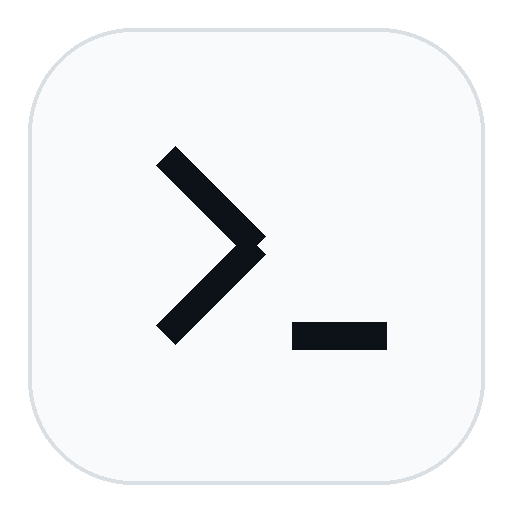
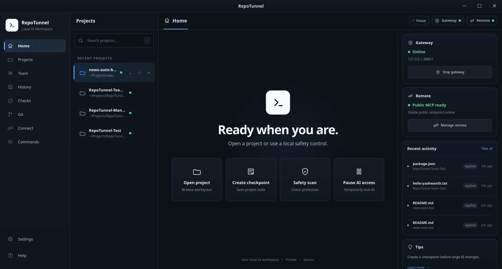

# RepoTunnel

**Work with your real projects from ChatGPT — with your computer's permissions still under your control.**

RepoTunnel is a local-first desktop gateway that connects ChatGPT Web and other compatible MCP clients to **projects you explicitly approve**. Explore code, make reviewed edits, run tests, use Git, and operate supported local tools without handing an AI unrestricted access to your computer.

[**Download**](#download-and-install) · [**Quick start**](#quick-start) · [**Capabilities**](#capabilities) · [**Security**](#security-and-permissions) · [**Documentation**](#documentation)

  

## Work with your projects directly from ChatGPT Web

After connecting RepoTunnel as an MCP app, you can ask ChatGPT to inspect the **actual approved project on your computer**, investigate a bug, make a targeted fix, run its checks, and report the real result in the same conversation. There is no need to repeatedly upload source files or paste terminal output. RepoTunnel is the **permissioned bridge**, not an alternative editor or a separate AI account.

RepoTunnel runs a local MCP gateway and enforces workspace boundaries, AI Review / AI Auto policies, secret protections, and separate grants for browser, desktop, Phone, and remote-machine capabilities. You retain control of project access, queued reviews, connection settings, and publishing.

**No RepoTunnel account is required.** Using an eligible ChatGPT account through its supported MCP app flow does not require purchasing an additional OpenAI API key for that conversation. ChatGPT plan limits and availability, optional OpenAI Secure Tunnel credentials or billing, and any other connection-provider fees are separate. **Direct HTTPS** is a different connection option and does not require an OpenAI API key.

For setup, see [Quick start](#quick-start), [connection methods](docs/connection.md), and [security boundaries](#security-and-permissions).

## How it works

1. **Choose a project.** Add or clone a repository; RepoTunnel gives it an approved workspace ID and a read-only or read/write access level.
2. **Choose how changes happen.** Use **AI Review** to approve supported changes locally, or **AI Auto** to permit actions within the boundaries you granted. You can pause AI access.
3. **Connect an AI client.** Expose the authenticated MCP endpoint using a supported HTTPS connection method; the underlying MCP service remains loopback-only.
4. **Work with real tools.** Let the AI inspect source, edit files, use guarded terminals, run tests, review Git, or operate an individually approved browser, desktop, or device capability.
5. **Inspect the evidence.** Check diffs, command output, process state, activity history, checkpoints, and resumable work before deciding what to do next.

~~~text
ChatGPT or another compatible MCP client
                  |
          Authenticated HTTPS / OAuth
                  |
       Selected connection transport
                  |
        RepoTunnel local MCP gateway
                  |
        Permissions and policy checks
                  |
     +------------+-------------+
     |            |             |
 Approved     Sandboxed     Opt-in browser,
 projects     commands      desktop, phone,
 and Git      and jobs      remote computers
~~~

## Capabilities

| Area | Available functionality |
| --- | --- |
| **Projects and files** | Approved local repositories; safe file inspection, search, create, patch, rename, move and delete; protected-path and symlink checks. |
| **Large repositories** | Indexed exploration, paged trees and directory listings, bounded text-range reads, resumable search, and stale-cursor protection. |
| **Editing and recovery** | AI Review / AI Auto, pending diffs, local history, cautious undo/restore, checkpoints, activity records and Project Memory. |
| **Terminal and processes** | Disposable verification environments, guarded real-workspace commands, durable managed processes, incremental output and bounded waiting/stop/restart. |
| **Git and GitHub** | Status, log and diff; validated staging and staged-only commits; secret checks; human-authorized publishing via a connected GitHub account. |
| **Browser and desktop** | Managed Chromium sessions, screenshots, DOM and network diagnostics, semantic interactions, mutation receipts and explicit desktop controls. |
| **AI Workspace** | Isolated application and desktop sessions for supported GUI workflows, with scoped project access and restrictions on self-control. |
| **Remote Computers** | Explicitly paired RepoTunnel machines, project-bound delegated tools, source inspection/synchronization and guarded remote jobs/artifacts. |
| **Android Phone** | Authorized wireless ADB or USB, scrcpy live view, apps/files/APKs, diagnostics and opt-in Phone Helper semantic actions. |
| **Team Mode and continuity** | Two coordinated AI engineers, task ownership and cross-review, long-work recovery, resume state and optional ChatGPT continuation extension. |
| **Video and design** | Video Intelligence/Production workflows and a source-reviewed Website Design Intelligence reference and planning catalog. |

Some capabilities depend on the operating system, installed third-party applications, user approvals, external service availability and experimental opt-ins. See [product scope](docs/product.md), [platform parity](docs/cross-platform-parity.md) and [acceptance criteria](docs/acceptance.md) for the boundaries; a packaged app is not a guarantee that every automation adapter is available on every machine.

## Quick start

### 1. Download and open RepoTunnel

Choose the installer for your operating system from [GitHub Releases](https://github.com/Yashwanth034/RepoTunnel/releases/latest). The [download table](#download-and-install) lists the supported package types.

### 2. Approve a workspace

In **Projects**, add an existing folder or clone a repository. Grant only the scope needed:

- **Read only** for inspection, or **Read / write** for authorized edits.
- **AI Review** for locally approved supported mutations, or **AI Auto** for policy-constrained automated actions.

Adding a project does not give the client access to the rest of the computer. Device, browser, desktop and remote-machine capabilities have their own controls.

### 3. Set up an HTTPS connection

Choose a transport in RepoTunnel's connection settings:

| Transport | What you need | When to use it |
| --- | --- | --- |
| **ngrok** | Your ngrok account/token and supported public endpoint | Managed HTTPS tunnel with straightforward setup. |
| **Cloudflare Tunnel** | Your Cloudflare tunnel configuration and installed `cloudflared` | Bring an existing Cloudflare-managed endpoint. |
| **Direct HTTPS** | A reachable hostname, routing and trusted TLS/ACME setup | Your own HTTPS route without a managed relay. |
| **OpenAI Secure MCP Tunnel** | A provisioned Tunnel ID, authorized runtime API key and supported official tunnel client | Optional OpenAI-managed secure tunnel connection. |

**Direct HTTPS and OpenAI Secure MCP Tunnel are different connection methods.** Direct HTTPS does not require an OpenAI API key. The optional Secure Tunnel uses a runtime API key in addition to its Tunnel ID; a Tunnel ID by itself does not authenticate. Provider usage or API billing, if applicable, is determined by the relevant provider—not by RepoTunnel.

For the optional Linux keyring feature, you can choose to remember Secure Tunnel credentials in the **system keyring**. This is opt-in. A remembered connection restores **paused**, and must be resumed explicitly.

See [remote MCP connection setup](docs/connection.md) and [Direct HTTPS setup](docs/direct-https.md).

### 4. Add RepoTunnel to your AI client

For ChatGPT, use the available custom MCP app / Developer Mode setup for your account or workspace:

1. Create a custom MCP app and enter the HTTPS MCP endpoint shown in RepoTunnel.
2. Select OAuth and complete RepoTunnel's authorization flow when using its public OAuth endpoint.
3. Discover or refresh tools, and verify the setup with a read-only request such as listing approved workspaces.
4. Ask the AI to inspect a specific approved project before authorizing edits or terminal commands.

ChatGPT's menus, access requirements and supported features can vary by plan and change independently of RepoTunnel. Other compatible MCP clients may have different connection steps.

## Security and permissions

RepoTunnel is intended to **reduce the authority granted to an AI tool**, not to bypass operating-system or application security.

| Boundary | How RepoTunnel handles it |
| --- | --- |
| **Project scope** | Explicit workspace IDs and workspace-relative paths; protected credentials and paths outside approved roots are rejected. |
| **Command execution** | Fail-closed OS-specific isolation: Bubblewrap (Linux), AppContainer/Job Objects (Windows) and the supported Seatbelt compatibility backend (macOS). |
| **Human review** | A remote MCP client cannot approve its own queued AI Review actions or silently raise local permissions. |
| **Git and publishing** | Staging/commits are validated; pushing or publishing requires an explicit human instruction and supported authorized connection. |
| **Network boundary** | The raw MCP service remains bound to loopback; remote traffic goes through the configured authenticated public boundary. |
| **Browser and desktop** | Scoped sessions, sensitive-field protections, short-lived semantic references and no blind replay of uncertain state-changing actions. |
| **Phone and computers** | Separate enrollment, grants and pause/revocation controls; AI cannot secretly pair a device or escalate its permissions. |
| **Secrets** | Protected file types, redacted output and narrowly scoped credential handling; optional keyring storage for supported tunnel credentials. |

A sandbox is not a substitute for reviewing permissions. RepoTunnel cannot guarantee safety for software the user launches outside RepoTunnel, or override rules imposed by an operating system, website, payment app or device.

Read the [security model](docs/security.md) and [security reporting policy](SECURITY.md) before granting higher-risk capabilities.

## Platform support

| Platform | Distributable | Important notes |
| --- | --- | --- |
| **Linux x64** | DEB, RPM, AppImage | Primary live-validated desktop platform; complete managed-process reattachment across a RepoTunnel restart is currently Linux-only. |
| **Windows x64** | NSIS EXE, MSI | Native builds and command-sandbox acceptance are tested in Windows CI; application/UI adapters depend on native support. |
| **macOS Apple Silicon** | DMG | Native build and Seatbelt acceptance are tested; in-app update installation is intentionally disabled for replacement/restore safety. |
| **macOS Intel** | DMG | Native build and Seatbelt acceptance are tested; the same in-app update-install safety gate applies. |

Android Phone Access is an optional connection to a separately authorized Android device, not an Android edition of the desktop application. Some features need optional companion tools or user-enabled permissions.

RepoTunnel checks official signed update metadata. **Update discovery does not mean in-app update installation is available on every OS.** See [release and update safety](docs/release.md).

## Download and install

All supported installers and accompanying updater files are published on the [**latest GitHub Release**](https://github.com/Yashwanth034/RepoTunnel/releases/latest).

| Operating system | Choose this file type |
| --- | --- |
| Debian / Ubuntu / Linux Mint (x64) | `.deb` |
| Fedora / other supported RPM Linux (x64) | `.rpm` |
| Compatible Linux distributions (x64) | `.AppImage` |
| Windows (x64) | NSIS `-setup.exe` or `.msi` |
| macOS Apple Silicon | `aarch64.dmg` |
| macOS Intel | `x64.dmg` |

The release includes `RepoTunnel-SHA256SUMS.txt`, separate `.sig` files and `latest.json` for supported signed updater flows. **Check the downloaded package against the checksum file before installation.** For a single Linux package, for example:

~~~bash
sha256sum RepoTunnel_*.deb
# Compare the output with the matching entry in RepoTunnel-SHA256SUMS.txt
~~~

Packages are built for the architectures shown. Third-party connection services, app installations and optional creative/Android tooling are not bundled unless documented separately.

## ChatGPT continuation extension

An optional Chromium extension is included in the source at [`extensions/chatgpt-continuation/`](extensions/chatgpt-continuation/).

It targets only **conversations you explicitly bind**. The RepoTunnel continuation mode can deliver authorized checkpoints when a saved conversation is idle. A separate manual-message mode can repeat your own saved message after a completed response. The extension checks for active generation, interruptions, human drafts, and uncertain sends; it will not overwrite user-entered text or blindly replay an unverified send.

To install from source, open `chrome://extensions`, enable **Developer mode**, select **Load unpacked** and choose `extensions/chatgpt-continuation`. Then bind the specific conversation from the extension.

[Extension instructions](extensions/chatgpt-continuation/README.md) · [Privacy](extensions/chatgpt-continuation/PRIVACY.md)

## Development

RepoTunnel uses **Tauri 2 + Rust** for its desktop backend and MCP runtime and **React 19 + TypeScript + Vite** for the interface.

~~~bash
git clone https://github.com/Yashwanth034/RepoTunnel.git
cd RepoTunnel
npm ci
npm run tauri dev
~~~

Useful project checks:

~~~bash
npm run check
npm run test:frontend
npm run test:browser
npm run build

cargo fmt --manifest-path src-tauri/Cargo.toml --all -- --check
cargo clippy --locked --manifest-path src-tauri/Cargo.toml --all-targets -- -D warnings
cargo test --locked --manifest-path src-tauri/Cargo.toml --lib -- --test-threads=1
~~~

Install the native dependencies required by Tauri for your operating system. Sandbox-sensitive Rust tests are intentionally run serially in CI. See [release engineering](docs/release.md) and [acceptance](docs/acceptance.md) before packaging or publishing an installer.

## Documentation

| Topic | Reference |
| --- | --- |
| Product and architecture | [Product](docs/product.md) · [Architecture](docs/architecture.md) · [Platform parity](docs/cross-platform-parity.md) |
| MCP and connectivity | [MCP interface](docs/mcp.md) · [Connection methods](docs/connection.md) · [Direct HTTPS](docs/direct-https.md) |
| Projects and work | [Project indexing](docs/project-index.md) · [Safe editing](docs/safe-editing.md) · [Commands](docs/commands.md) · [Git](docs/git.md) |
| Advanced capabilities | [Remote Computers](docs/remote-computers.md) · [Team Mode](docs/team-mode.md) · [Android Phone](docs/phone-access.md) · [Video](docs/video.md) |
| Design and continuity | [Website Design Intelligence](docs/website-design-intelligence.md) · [AI Continuity](AI_CONTINUITY.md) · [Semantic interaction](SEMANTIC_INTERACTION_LAYER.md) |
| Safety and releases | [Security model](docs/security.md) · [Release process](docs/release.md) · [Acceptance checks](docs/acceptance.md) · [Changelog](CHANGELOG.md) |

## Contributing and support

Bug reports, feature requests and contributions are welcome through [GitHub Issues](https://github.com/Yashwanth034/RepoTunnel/issues). Include your platform, relevant reproducible steps and non-sensitive diagnostics. For vulnerabilities, follow [SECURITY.md](SECURITY.md)—do not post credentials or private files publicly.

RepoTunnel is released under the [MIT License](LICENSE).

Copyright © 2026 Yashwanth.
